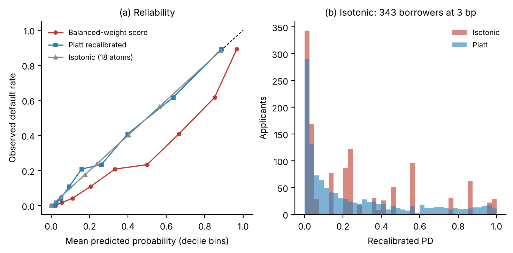

# From Scores to Capital and Prices

**How calibration, selection and regulatory treatment move Basel III outcomes in SME lending. Evidence from 1,200 Bangladeshi SME loans and five public credit datasets.**

Anmita Das and Shoumya Chowdhury, University of Melbourne. Manuscript in preparation (2026).

A credit score is useful to a lender only after it passes through three things: a regulatory capital formula (Basel III IRB), a risk-based price (RAROC), and an approval decision under a rate ceiling. This repository follows one probability of default through all three, measures how each modelling choice and each data limitation changes the outcome, and checks the central findings on datasets from five other countries. Every number and table in the paper is generated by the code here.



## The findings in one minute

| Question | Answer on the Bangladeshi data (n = 1,200, 25.25% default) |
|---|---|
| Does class weighting matter? | Yes. A class-balanced score has mean PD 37.1% against 25.25% observed. Used as a probability it makes about 36% of borrowers priceable under a 22% rate ceiling. Recalibrated, 49%. |
| Which recalibrator? | Isotonic regression collapses 1,200 borrowers onto 18 PD values, puts 28.6% of them at 3 basis points, and understates Tier 1 capital by 10.4%. Platt scaling is used as the primary recalibrator. |
| Are subgroups miscalibrated? | Mostly no. After recalibration no subgroup is significantly biased, and the spread across 18 subgroups in bias and AUC is within what a perfectly calibrated model produces by chance. Weak slope heterogeneity in two groups. |
| What could undetectable subgroup error cost? | Group capital between -18% and +38%, group rates between -5.2 and +5.3 percentage points (bounds from confidence limits). |
| Does selection bias matter? | Yes, more than subgroup effects. A model trained on a historically screened sample under-predicts default among excluded applicants by 7 to 13 points. Inverse-propensity weighting does not fix it. |
| Retail or corporate Basel treatment? | Retail lowers mean capital by 38.1%. Default definition (a Basel-like 90 days past due) moves the priceable share by 13.8 points at an illustrative conversion share of one half. |
| Flat 18% vs risk-based pricing? | Flat loses BDT 236 million on the sample. RAROC pricing earns the hurdle return. The fall in default rate (25.3% to 3.5% out of fold) comes from the approval screen, not from the price. |
| Who is screened out? | Rural approval 39.0% against 52.6% urban. |
| Policy remedy? | In a stylised design, a guarantee that absorbs only unexpected loss restores BDT 195 million of credit at zero expected outlay. |
| Does it generalise? | Calibration and recalibrator findings replicate on Germany, Taiwan, the US, Poland and Australia. Subgroup slope heterogeneity is clearly detectable in the 150,000-borrower US sample. |

Full numbers, intervals and caveats are in the paper and in [docs/04-Results-Guide.md](docs/04-Results-Guide.md).

## Repository map

```
.
├── README.md                    this file
├── run_all.sh                   reproduce everything (about 15 to 20 minutes)
├── requirements.txt
├── data/
│   ├── bangladesh_sme_1200_records.csv     the 1,200 SME loan records
│   ├── DATA_DICTIONARY.md                  every column explained
│   └── external/                           created by the replication script (public data sets)
├── code/
│   ├── common.py                           data loading, Basel K, pricing, Platt/isotonic, calibration helpers
│   ├── 01_core_pipeline.py                 PD to capital to price to decision; recalibrators; regimes; sensitivity; guarantee
│   ├── 02_subgroup_calibration.py          bootstrap CIs, tests and sampling null for 18 subgroups
│   ├── 03_recalibration_by_group.py        global vs per-group recalibration, cross fitted
│   ├── 04_weighting_selection_fairness_robustness.py   class weighting, truncation experiment, fairness, take-up, downturn, collateral LGD
│   ├── 05_bootstrap_and_bounds.py          headline bootstrap CIs; capital and price error bounds
│   ├── 06_external_replication.py          five-country replication
│   ├── 07_isotonic_vs_sample_size.py       isotonic artefact against sample size
│   ├── 08_figures.py                       all figures
│   ├── 09_build_paper.py                   builds every table and number into main.tex
│   └── external_helpers.py
├── results/                     every output table (CSV and JSON), so you can read results without running anything
├── paper/
│   ├── main_template.tex        manuscript with placeholders for numbers and tables
│   ├── main.tex                 generated manuscript (do not edit by hand, edit the template)
│   ├── main.pdf                 compiled manuscript
│   ├── references.bib
│   └── figures/
└── docs/                        documentation pages (also usable as wiki pages)
```

## Quick start

```bash
git clone https://github.com/shoumyac/sme-credit-risk-capital-pricing.git
cd sme-credit-risk-capital-pricing
python -m venv .venv && source .venv/bin/activate     # Windows: .venv\Scripts\activate
pip install -r requirements.txt
bash run_all.sh                       # or run the scripts in code/ in numerical order
cd paper && pdflatex main && bibtex main && pdflatex main && pdflatex main
```

To only look at results, open the CSV files in `results/`. [docs/05-Reproducibility.md](docs/05-Reproducibility.md) explains seeds, runtime and troubleshooting.

## Where to start reading

1. [docs/01-Project-Overview.md](docs/01-Project-Overview.md) for the idea and the contributions.
2. [docs/03-Methodology.md](docs/03-Methodology.md) for the equations and the design of each experiment.
3. [docs/04-Results-Guide.md](docs/04-Results-Guide.md) to map each paper table to a script and a result file.
4. [docs/06-Limitations-and-Open-Problems.md](docs/06-Limitations-and-Open-Problems.md) and [docs/07-Future-Work.md](docs/07-Future-Work.md) for what is not solved and where to extend.

## Data

The 1,200 Bangladeshi SME loan applications (2022 to 2023) were obtained from BASIC Bank Limited and Bangladesh Bank for this research, with permission from the Ministry of Finance of Bangladesh. The extract contains no personal identifiers and is shared here for research use. See [data/DATA_DICTIONARY.md](data/DATA_DICTIONARY.md) and [docs/02-Data.md](docs/02-Data.md). The five replication datasets (German credit, Taiwan card default, Give Me Some Credit, Polish companies bankruptcy, Australian credit approval) are public and are downloaded by `code/06_external_replication.py`; they are not redistributed here.

## Honest limitations

Loss given default, the rate ceiling and the cost of funds are assumed. Rejected-applicant outcomes are not observed, so selection bias is sized by experiment rather than corrected. The default label is any missed payment, wider than the Basel definition. The replication datasets are not all SME loans. The full register is in [docs/06-Limitations-and-Open-Problems.md](docs/06-Limitations-and-Open-Problems.md).

## Related work by the authors

- Chowdhury and Das, *Benchmarking explainability methods for SME credit risk models in emerging markets*, IntelliSys 2026, Springer. DOI 10.1007/978-3-032-32729-1_33.
- Chowdhury, Das and Paul, *Federated explainability under distribution shift*, under review at *Machine Learning*.
- Two shorter papers on this data were accepted at the 3rd AI in Finance Conference (Concordia University, Montreal, October 2026); this repository contains the merged and extended study.

## Citation and licence

Cite using [CITATION.cff](CITATION.cff). Code: MIT licence (`LICENSE`). Data, text and figures: CC BY 4.0 (`LICENSE-DATA-AND-PAPER`).

## Contact

Open a GitHub issue, or write to the corresponding author, Shoumya Chowdhury (shoumyac@student.unimelb.edu.au).
